# Сравнение алгоритмов кеширования

## Мной были реализованы такие из них:
- 1. LRU
- 2. LFU
- 3. 2Q
- 4. LIRS
- 5. ARC
- 6. *Идеальное кеширование (OPT)

## Teстирование

Я написала тесты по каждому из этих алгоритмов. Также написала бенчмарки - тесты, которые на большом количестве итераций позволяют сравнить производительность алгоритмов в практических условиях.

### Бенчмарки на паттерны

Я получила такие результаты:

pattern |  LRU  |   LFU    |  2Q   | LIRS   |  ARC |  OPT
-------|---------|----------|-------|--------|--------|------
scan       |  0.000 |  0.449  | 0.000  | 0.449  | 0.000 | 0.473
hot       |   0.601  | 0.761  | 0.687  | 0.742  | 0.718 | 0.797
mixed      |  0.360 | 0.496  | 0.493  | 0.496  | 0.494 | 0.496

> Note: [Смотреть общие графики по scan/hot/mixed/phase](#2-тест-при-котором-происходит-смена-рабочего-набора-чтобы-увидеть-или-хотя-бы-попытаться-что-arc-на-таких-паттернах-работает-эффективнее)

##### Наблюдения:
- `Scan`: у LRU, который понятно, почему так работает, и 2Q, который тут ведет себя как LRU, не успевая ничего повысить до am, по 0.
- `Hot`: выигрывает LFU, ибо считать частоты на частотно-скошенной нагрузке -- самое логичное, а это буквально то, под что он расчитан. ARC отстаёт от LFU потому, что T2 упорядочен не по частоте, а по недавности — в T2 попадают ключи с >= 2 обращениями, но внутри он сортирует по давности последнего обращения, а не по тому, насколько ключ частый.
- `Mixed`: LFU == OPT (шок). 2Q ~= OPT ~= ARC. LRU сильно отстает, снова давая понять, что такой алгоритм не оптимальный.
- Про 0.000 у LRU, 2Q и ARC в scan: 0 у 2Q и LRU оправдан, потому что они вообще неустойчивы к scan. А вот для ARC 0 на scan - аномалия.
- При прочих равных LIRS здесь лучший выбор, чем ARC.

Итог:
- Лучше всего себя показал LFU, совсем немного отстает LIRS, 2Q среднячок, LRU же очень сильно проваливается на всех стратегиях. Но пока это рассуждения только для стационарных случаев.

### Бенчмарки на мультиуровневое кеширование

Я решила протестировать взаимодействие алгоритмов кеширования при 2 уровнях.

Прогоняла по 30-ти разным seed'ам.

> Формула вычисления: `cost = 1 * H1 + 10 * H2 + 100 * miss`

Получила такие результаты:

L1 = 3, L2 = 15, pattern hot, trace length: 10000

| config      | H1   | H2   | miss | hr    | cost   |
|-------------|------|------|------|-------|--------|
| LRU + LRU   | 1958 | 5697 | 2345 | 0.765 | 293428 |
| LRU + LFU   | 1958 | 6316 | 1726 | 0.827 | 237718 |
| LRU + 2Q    | 1958 | 6292 | 1750 | 0.825 | 239878 |
| LRU + LIRS  | 1958 | 6309 | 1733 | 0.827 | 238348 |
| LRU + ARC   | 1958 | 6225 | 1817 | 0.818 | 245908 |
|             |      |      |      |       |        |
| LFU + LRU   | 2268 | 5757 | 1975 | 0.802 | 257338 |
| LFU + LFU   | 2268 | 6013 | 1719 | 0.828 | 234298 |
| LFU + 2Q    | 2268 | 6040 | 1692 | 0.831 | 231868 |
| LFU + LIRS  | 2268 | 6044 | 1688 | 0.831 | 231508 |
| LFU + ARC   | 2268 | 5991 | 1741 | 0.826 | 236278 |
|             |      |      |      |       |        |
| 2Q + LRU    | 2232 | 5423 | 2345 | 0.765 | 290962 |
| 2Q + LFU    | 2232 | 6036 | 1732 | 0.827 | 235792 |
| 2Q + 2Q     | 2232 | 5983 | 1785 | 0.822 | 240562 |
| 2Q + LIRS   | 2232 | 6012 | 1756 | 0.824 | 237952 |
| 2Q + ARC    | 2232 | 5923 | 1845 | 0.816 | 245962 |
|             |      |      |      |       |        |
| LIRS + LRU  | 2261 | 5311 | 2428 | 0.757 | 298171 |
| LIRS + LFU  | 2261 | 6000 | 1739 | 0.826 | 236161 |
| LIRS + 2Q   | 2261 | 5985 | 1754 | 0.825 | 237511 |
| LIRS + LIRS | 2261 | 6006 | 1733 | 0.827 | 235621 |
| LIRS + ARC  | 2261 | 5914 | 1825 | 0.818 | 243901 |
|             |      |      |      |       |        |
| ARC + LRU   | 2073 | 5548 | 2379 | 0.762 | 295453 |
| ARC + LFU   | 2073 | 6195 | 1732 | 0.827 | 237223 |
| ARC + 2Q    | 2073 | 6172 | 1755 | 0.825 | 239293 |
| ARC + LIRS  | 2073 | 6194 | 1733 | 0.827 | 237313 |
| ARC + ARC   | 2073 | 6106 | 1821 | 0.818 | 245233 |

OPT (size L1 + L2 = 18): hits = 8746, hr = 0.875

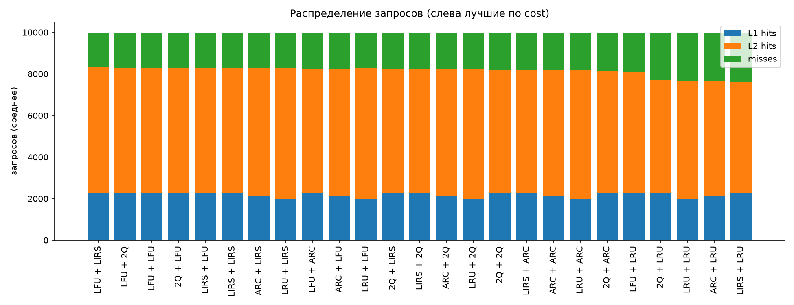
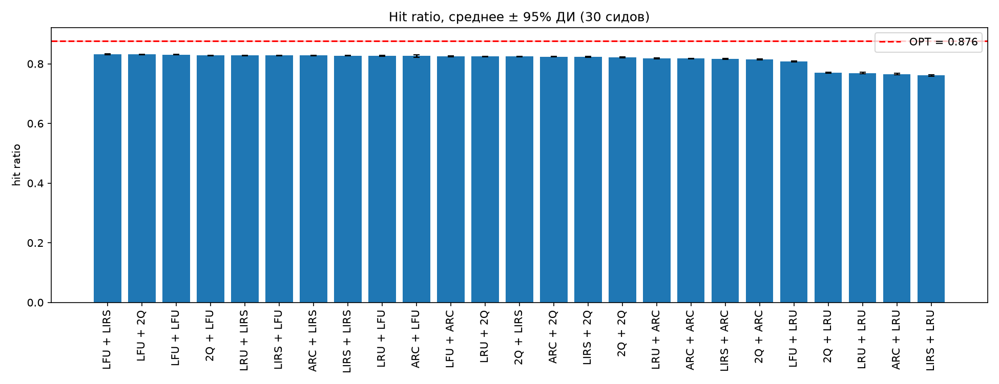
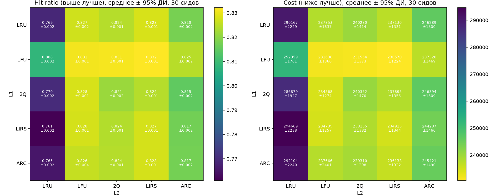

#### Наблюдения:
- H1 зависит только от выбора L1
- Лучший многоуровневый -- 0.828 против OPT на суммарном размере 18 -> 0.875. То есть разбиение на 2 уровня само по себе теряет ~0.047 относительно монолитного кеша того же суммарного объема.
- LFU + LFU, LRU + LFU, LRU + LIRS, ARC + LFU - в топе и почти не отстают от OPT.
- При этом из-за того, что l2.size() = 15, а l1.size() = 3, то большинство hit'ов приходится на него. -> Надо бы прогнать бенчмарки при l1.size() = l2.size().
- Взаимодействие уровней нелинейно!!
- hr получился почти одинаковым, а вот cost -- нет. Делаю вывод, что такая модель играет важную роль в определении эффективности алгоритмов кеширования.

### В ходе прошлых опытов поняла, что нужно протестировать:
### 1. l1.size() == l2.size()

Получила вот такие результаты:

L1 = 9, L2 = 9, pattern hot, trace length: 10000
| config      | H1   | H2   | miss | hr    | cost   |
|-------------|------|------|------|-------|--------|
| LRU + LRU   | 5514 | 551  | 3935 | 0.607 | 404524 |
| LRU + LFU   | 5514 | 939  | 3547 | 0.645 | 369604 |
| LRU + 2Q    | 5514 | 1637 | 2849 | 0.715 | 306784 |
| LRU + LIRS  | 5514 | 1905 | 2581 | 0.742 | 282664 |
| LRU + ARC   | 5514 | 1635 | 2851 | 0.715 | 306964 |
|             |      |      |      |       |        |
| LFU + LRU   | 6921 | 1298 | 1781 | 0.822 | 198001 |
| LFU + LFU   | 6921 | 1322 | 1757 | 0.824 | 195841 |
| LFU + 2Q    | 6921 | 1370 | 1709 | 0.829 | 191521 |
| LFU + LIRS  | 6921 | 1390 | 1689 | 0.831 | 189721 |
| LFU + ARC   | 6921 | 1382 | 1697 | 0.830 | 190441 |
|             |      |      |      |       |        |
| 2Q + LRU    | 6279 | 1057 | 2664 | 0.734 | 283249 |
| 2Q + LFU    | 6279 | 1004 | 2717 | 0.728 | 288019 |
| 2Q + 2Q     | 6279 | 1134 | 2587 | 0.741 | 276319 |
| 2Q + LIRS   | 6279 | 1162 | 2559 | 0.744 | 273799 |
| 2Q + ARC    | 6279 | 1256 | 2465 | 0.753 | 265339 |
|             |      |      |      |       |        |
| LIRS + LRU  | 6813 | 709  | 2478 | 0.752 | 261703 |
| LIRS + LFU  | 6813 | 663  | 2524 | 0.748 | 265843 |
| LIRS + 2Q   | 6813 | 881  | 2306 | 0.769 | 246223 |
| LIRS + LIRS | 6813 | 776  | 2411 | 0.759 | 255673 |
| LIRS + ARC  | 6813 | 866  | 2321 | 0.768 | 247573 |
|             |      |      |      |       |        |
| ARC + LRU   | 6530 | 538  | 2932 | 0.707 | 305110 |
| ARC + LFU   | 6530 | 733  | 2737 | 0.726 | 287560 |
| ARC + 2Q    | 6530 | 1064 | 2406 | 0.759 | 257770 |
| ARC + LIRS  | 6530 | 995  | 2475 | 0.752 | 263980 |
| ARC + ARC   | 6530 | 977  | 2493 | 0.751 | 265600 |

OPT (size L1 + L2 = 18): hits = 8746, hr = 0.875

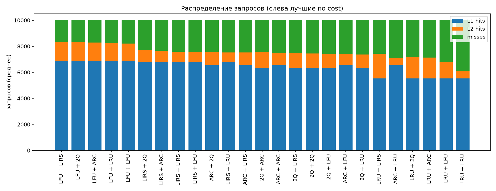
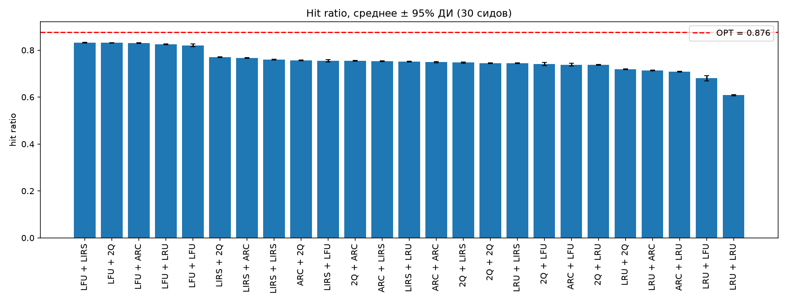
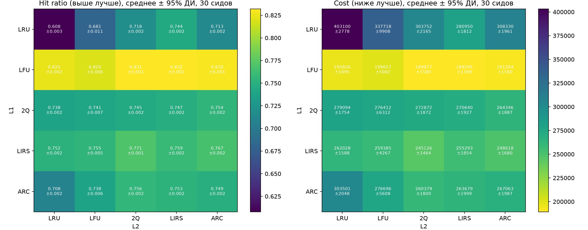

#### Наблюдения (L1 = L2 = 9):
- Теперь выбор алгоритма L1 важен: разброс 0.607...0.824 (в 3/15 все были ~0.827).
  -> раньше "L1 не важен" -- артефакт мелкого L1, а не правда.
- Равный сплит -> хиты уходят в дешевый L1 (H1 у LFU+LFU 2268 -> 6921),
  cost падает 234k -> 196k. Но у слабых конфигов hr проседает (LRU+LFU 0.827 -> 0.645),
  ибо ужатый L2 хуже держит ядро. Устойчив только LFU+LFU.
- -> соотношение размеров уровней -- сам по себе параметр настройки.
- Потеря от двухуровневости ~0.05 hr и почти не зависит от разделения.
- Из-за inclusive способа решения проблемы удаления данных при вытеснении из L1 получается при равных хранилищах, что L2 просто дублирует L1, поэтому и hit'ов в L2, собственно, почти и нет. Такое распределение размеров просто невыгодно, нужно хотя бы какое-то различие в размерах.

### 2. Тест, при котором происходит смена рабочего набора, чтобы увидеть (или хотя бы попытаться), что ARC на таких паттернах работает эффективнее

pattern    |    LRU   |  LFU   |   2Q  |  LIRS  |   ARC   |  OPT
------|---------|------------|--------|--------|----------|-------
phase   |     0.574 |  0.409 |  0.678 |  0.740  |  0.732 | 0.778

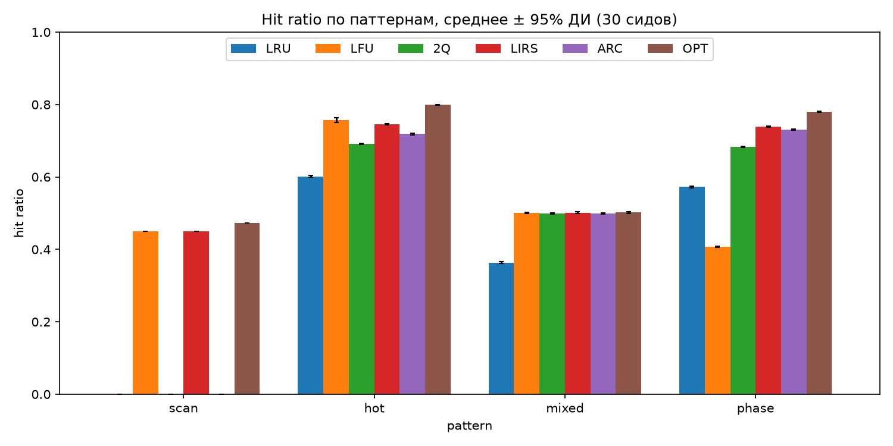
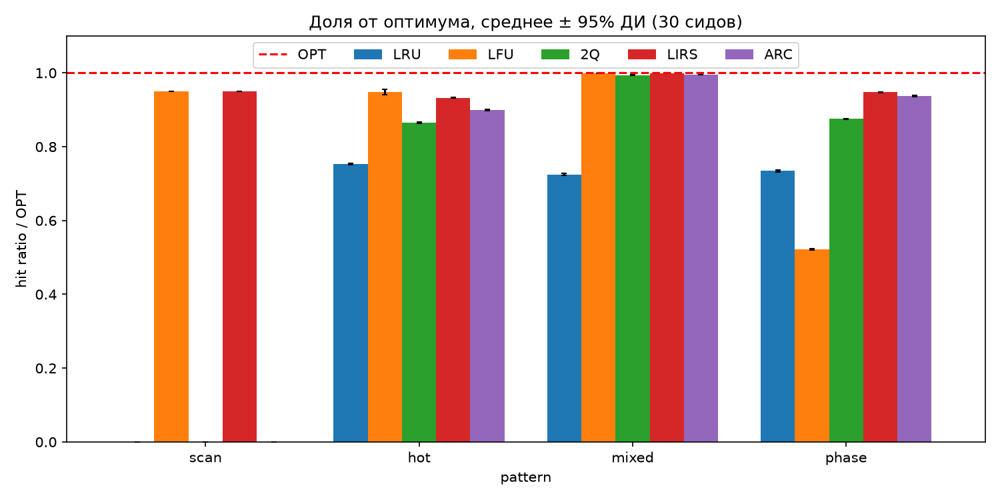

##### Наблюдения (по phase):
- Единственный нестационарный паттерн: ядро меняется на середине (1...10 -> 200...210).
- `LFU`: 0.409 - из лучшего стал худшим (шок наоборот). Это старение: счетчики
  старого ядра большие -> LFU держит уже ненужное, а новое не пускает.
- `LIRS`: 0.740 - лучший среди онлайн.
- `ARC`: 0.732 - 2-ой среди онлайн. Наконец-то адаптивность p пригодилась.
- `LRU`: 0.574, быстро забывает -> адаптируется, но все еще тратится на шум.
- По [пункту выше](#бенчмарки-на-паттерны) можем сделать вывод, что только LIRS нигде не провалился
- Вывод: LFU был "лучшим" только потому, что все прошлые паттерны стационарны.
  На меняющейся нагрузке "рулят" адаптивные (ARC/LIRS).

### 3. Многоуровневые бенчмарки при phase-shift, а не hot

| config      | H1   | H2   | miss | hr    | cost   |
|-------------|------|------|------|-------|--------|
| LRU + LRU   | 1889 | 5404 | 2707 | 0.729 | 326629 |
| LRU + LFU   | 1889 | 3098 | 5013 | 0.499 | 534169 |
| LRU + 2Q    | 1889 | 6124 | 1987 | 0.801 | 261829 |
| LRU + LIRS  | 1889 | 6143 | 1968 | 0.803 | 260119 |
| LRU + ARC   | 1889 | 6136 | 1975 | 0.802 | 260749 |
|             |      |      |      |       |        |
| LFU + LRU   | 1423 | 6085 | 2492 | 0.751 | 311473 |
| LFU + LFU   | 1423 | 3454 | 5123 | 0.488 | 548263 |
| LFU + 2Q    | 1423 | 6601 | 1976 | 0.802 | 265033 |
| LFU + LIRS  | 1423 | 6615 | 1962 | 0.804 | 263773 |
| LFU + ARC   | 1423 | 6610 | 1967 | 0.803 | 264223 |
|             |      |      |      |       |        |
| 2Q + LRU    | 2189 | 5140 | 2671 | 0.733 | 320689 |
| 2Q + LFU    | 2189 | 3167 | 4644 | 0.536 | 498259 |
| 2Q + 2Q     | 2189 | 5820 | 1991 | 0.801 | 259489 |
| 2Q + LIRS   | 2189 | 5844 | 1967 | 0.803 | 257329 |
| 2Q + ARC    | 2189 | 5833 | 1978 | 0.802 | 258319 |
|             |      |      |      |       |        |
| LIRS + LRU  | 2214 | 4996 | 2790 | 0.721 | 331174 |
| LIRS + LFU  | 2214 | 2952 | 4834 | 0.517 | 515134 |
| LIRS + 2Q   | 2214 | 5796 | 1990 | 0.801 | 259174 |
| LIRS + LIRS | 2214 | 5819 | 1967 | 0.803 | 257104 |
| LIRS + ARC  | 2214 | 5811 | 1975 | 0.802 | 257824 |
|             |      |      |      |       |        |
| ARC + LRU   | 2030 | 5215 | 2755 | 0.725 | 329680 |
| ARC + LFU   | 2030 | 3042 | 4928 | 0.507 | 525250 |
| ARC + 2Q    | 2030 | 5983 | 1987 | 0.801 | 260560 |
| ARC + LIRS  | 2030 | 6002 | 1968 | 0.803 | 258850 |
| ARC + ARC   | 2030 | 5995 | 1975 | 0.802 | 259480 |

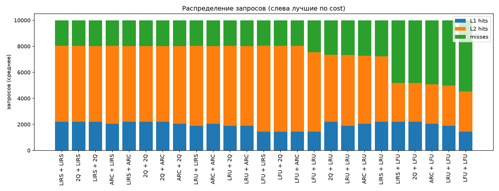
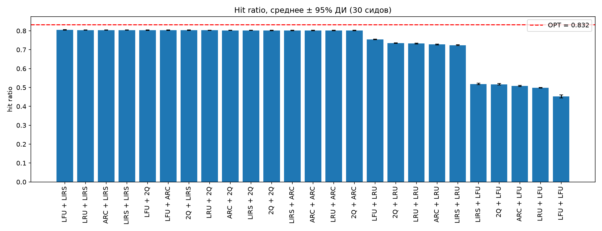
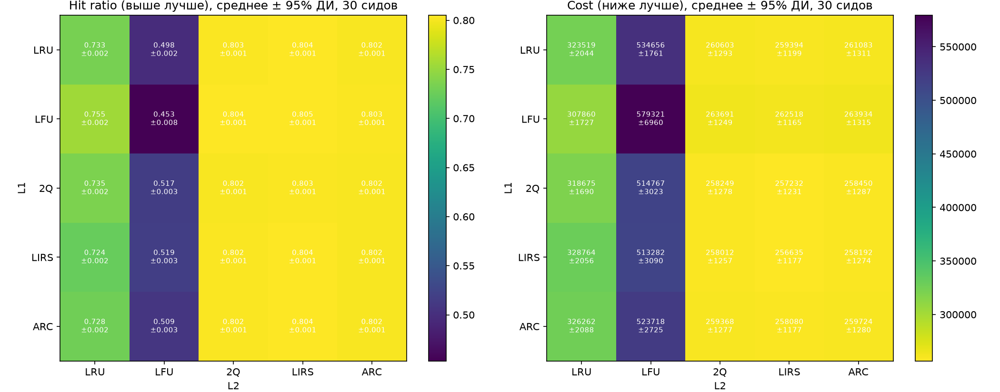

#### Наблюдения

Здесь уже видим совершенно другой расклад:
- LRU+ARC = ARC+ARC = LRU+LIRS ~= 0.802 -> алгоритм L1 почти не влияет, важен только L2.
- Что логично: L2 большой, там вся емкость. Если L2 адаптивный (ARC/LIRS) -- ок,
  даже с LRU впереди. Если в L2 LFU - все плохо, даже с ARC впереди.
- hr от L1 не зависит, а cost чуть-чуть: ARC впереди ловит больше в дешевый L1 -> дешевле.

## Итог
- Универсального лучшего нет: стационар -> LFU, смена набора -> ARC/LIRS, scan -> кто не по recency.
- Лучшего алгоритма нет — есть удачная ставка на будущее. LFU выигрывает, пока мир стабилен, и проигрывает первым, когда мир меняется. Aдаптивные же нечасто первые, но и никогда не последние. :):)


## Тестирование на "кастомизированных данных"

Примеры:

```
./cache_simulator --single lru:100
./cache_simulator --multi lru:3,lfu:15
./cache_simulator --multi lru:3,lfu:15,arc:100 --costs 1,10,50,200
./cache_simulator --single lru:18 --multi lru:3,lfu:15
./cache_simulator --length 5000 --seeds 10 --out csvs/my.csv
./cache_simulator
./cache_simulator --help
```

Выводится соотвественно вот такая таблица:

100 --costs 1,10,50,200
pattern hot, trace length: 10000, seeds: 30 (table for seed 1)

config                        |    L1   |   L2   |   L3  |  miss | hit_ratio  |      cost
------------------------------|----------|---------|--------|---------|------------|----
lru:3 -> lfu:15 -> arc:100    |  1937   | 6301   | 1662  |   100  |   0.990   |   168047
OPT(118)                      |  9900   |    0   |    0  |   100   |  0.990   |        0
